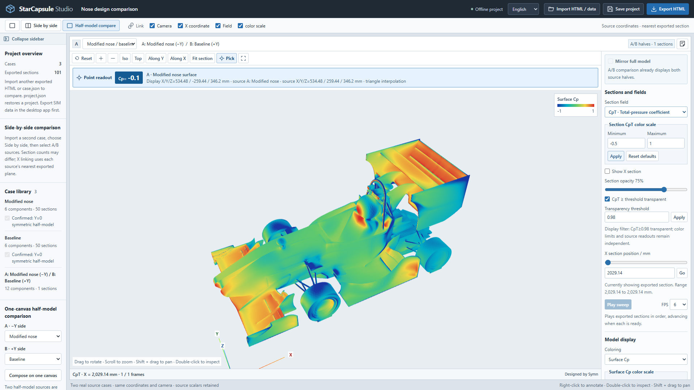

# StarCapsule

**Your STAR-CCM+ results. One portable, interactive, offline HTML.**

Created by **Symn · Jilin University**.

[Download for Windows](https://github.com/symnyan9/StarCapsule/releases/tag/v0.3.1) · [Releases](https://github.com/symnyan9/StarCapsule/releases) · [](https://github.com/symnyan9/StarCapsule/actions/workflows/ci.yml)

[简体中文](#简体中文) · [独立中文文档](README.zh-CN.md) · [Installation](docs/INSTALL.md) · [Review guide](docs/REVIEW.md) · [STAR adapter](docs/STAR_ADAPTER.md) · [Data format](docs/DATA_FORMAT.md) · [Templates](docs/TEMPLATES.md) · [Validation](docs/VALIDATION.md)

StarCapsule Studio turns selected results from saved STAR-CCM+ simulations into a portable 3D workspace. Send a single HTML file: reviewers can rotate the model, sweep real exported sections, inspect source-valued picks, compare cases and record comments without installing STAR, Python or a server.

Keep geometry, scalar fields, source identities and review settings together. Append results to the same workspace, compare A/B views or two half-models under one camera, then export an HTML that reopens with the cases and review state intact. Use it for design reviews, technical presentations and a portable catalog of selected results. Everything needed for viewing travels with the file; no CDN, cloud account or AI service is required.

Large data slots use lossless gzip with bounded Base64 chunks. Exported geometry and numeric precision are retained without automatic mesh reduction or rounding. Startup releases decoded data text and avoids repeated internal validation; same-canvas comparisons reuse unchanged arrays and store derived compositions as small recipes. Actual speed and capacity still depend on geometry density and the reviewing device. See the [validation record](docs/VALIDATION.md) for measured scope.



The screenshot compares the author's real baseline and modified-nose vehicle cases on one canvas. Downloadable example files use **synthetic demonstrations**; the real source simulations, vehicle meshes and field datasets remain private.

## Why StarCapsule

- **Deliver an interactive result, not just an image.** Inspect exported geometry, local scalar values and real sections under freely chosen views.
- **Compare within the same workspace.** Collect multiple cases, select A/B sources and link their views; compare compatible half-models on one canvas.
- **Keep the discussion with the evidence.** Save comments and display state, then reopen or pass the review to another person.
- **Make it your team's deliverable.** Embed local logos, colors, fonts and surrounding content through a validated HTML/CSS template.
- **Reduce setup for recipients.** The selected data and viewer travel in one offline HTML. Native extraction runs through your local STAR installation without manually opening its GUI.

The HTML is a selected-result snapshot, not a replacement for the complete `.sim` or a solver. File and memory requirements depend on what you select. See [project positioning](docs/GITHUB_LAUNCH.md).

## Language

English is the default. Select **简体中文** in the desktop or HTML header to switch in place. The desktop remembers its local preference; exported HTML and project JSON save their language with the review. Source object names, field names and user text keep their original spelling. English and Chinese installation, review and template guides are included.

```powershell
python run.py demo --language en --output review-en.html
python run.py build case.json --language zh-CN --output review-zh.html
```

## Select a SIM and export

For Windows x64, use the complete `StarCapsule-Studio-0.3.1-Windows-x64.zip` release package. Extract the entire ZIP, then double-click **Install.cmd** and launch **StarCapsule Studio** from the desktop. **Launch.cmd** also runs the extracted package directly. Python and Tk are included; the native SIM export still requires your compatible, licensed STAR installation.

See the [installation guide](docs/INSTALL.md) for Chinese installer messages and portable use.

On Windows, double-click **Open Studio.cmd** in the source checkout, or run:

```powershell
python run.py gui
```

After installation, use the **StarCapsule Studio** desktop shortcut, the local `Launch.cmd`, or `starcapsule-gui` in the installed Python environment.

1. Choose a solved `.sim` and click **Read simulation** to inventory its saved state. Leave the STAR executable field empty for local discovery, or select it explicitly.
2. Select vehicle walls in **Boundary surfaces**, and/or existing face objects in **Existing postprocessing**. Boundary lists retain other source boundaries too; choose the vehicle walls for body Cp. The latter tab lists mesh-capable derived parts under their source scenes. Choose the existing scalar, display limits and opacity you need.
3. Optionally enable real X sections. Selected wall bounds supply the initial X start/end; manual edits are preserved, and **Use selected bounds** restores the selected bounds. Choose the fluid region and section count or an explicit X list.
4. Choose an HTML destination and click **Export and open HTML**.

The native Tkinter window stays responsive during background work, shows status, supports cancellation of its owned process, and opens the finished report. **Task folder** opens the latest job's exports and logs. The desktop default is two STAR ranks; increase it only with suitable memory and licensing headroom.

**Finite-volume mesh** offers only source representations confirmed by STAR as finite-volume meshes with saved cells, automatically selecting `Volume Mesh` when available. Localized descriptions retain the exact source name; geometric, proxy, empty and unknown representations are hidden. Mesh presence alone is not evidence of convergence. Re-read the SIM after updating from an older inventory. Labels also distinguish coefficient functions, display-only color limits, spatial section counts and the optional X list; entering that list replaces the start/end/count settings.

The desktop Cp selector offers only an available `PressureCoefficient`; the CpT selector offers only an available `TotalPressureCoefficient`. Both include **Do not export**. Other source scalars remain in the existing-layer coloring selector, retaining their own quantity labels and units rather than being mislabeled as coefficients. A layers-only report can leave Cp/CpT empty. Vehicle-wall selections take priority for automatic X bounds: adding a long wake layer does not redefine vehicle length. Missing bounds remain a visible request for a wall selection or manual coordinates.

## Open a demonstration

Open [examples/review-demo.html](examples/review-demo.html) in a desktop browser with WebGL. Viewing an exported report requires neither Python nor STAR. To generate a new synthetic example with Python 3.10+:

```powershell
python run.py demo --output review.html
```

Windows also has `Open Demo.cmd`. Use a new output filename; the CLI's explicit `--force` option replaces an existing HTML/JSON output. The native export dialog preserves existing HTML files and asks for a new name.

## Review tools

| Tool | Behavior |
| --- | --- |
| Geometry inspection | Rotate, pan, zoom, fit, fullscreen; independent component/layer visibility and opacity |
| Real section sweep | Manual X-plane selection, play/pause and automatic back-and-forth spatial sweep |
| Scalar inspection | Cp/CpT switching; independent surface, section and layer color limits; editable CpT transparency threshold; source-valued picking |
| Two-view comparison | Append exported HTML or case JSON, select any A/B cases, and link cameras, physical section position, scalar and color limits independently |
| Same-canvas half-model comparison | Place source A on −Y and B on +Y under one camera, with source-attributed geometry and picks; two-view comparison remains available |
| Existing postprocessing | Display selected source isosurfaces, planes and other supported face meshes, with optional scalar values |
| Editing and comments | Edit report/case names; collapse the sidebar; right-click to record a comment and restore its scientific display state |
| Portable output | Save all loaded cases, selected A/B views, settings and comments in a new standalone HTML; reopen offline and continue choosing cases |

**Add a second result:** click **Import HTML / data**, choose another exported `.html`/`.htm` or a single `case.json`, then use **Compare** and select the desired A/B sources. Repeating import builds a multi-case library; only the selected two are rendered. Importing `project.json` instead restores that entire project, replacing the open project. HTML import reads validated embedded data only: the current editor and template remain in use; imported page scripts, styles and external elements are not executed or copied. See the [review guide](docs/REVIEW.md) for the complete workflow.

Two-view comparison accepts different section counts: X linking selects each source's nearest exported physical plane and exposes its actual position. Same-canvas half-model stitching is stricter. It requires two distinct actual Y=0 half-model sources in consistent coordinates, and its shared section sweep uses only common actually exported X planes and shared fields. Equal section counts alone do not establish matching coordinates. With zero common planes, surfaces/layers remain comparable; one common plane supports a fixed section comparison. A spatial sweep needs at least two common planes.

If a genuine half-model was exported without the half-model flag, its case-library checkbox **I confirm the source is a Y=0 symmetric half-model** records the user's explicit symmetry declaration after a one-sided geometry check. It preserves raw arrays/source identity and does not enable automatic full-car mirroring. The declaration can be undone before use in a composition; once referenced, it stays locked to preserve that composition and its comments. Source-declared half models retain their original declaration. Coefficient references remain attached separately; comparison does not normalize them automatically.

**Hide high-CpT background:** enable **CpT ≥ threshold: transparent**, enter a finite threshold and apply. The default is **0.98**; values at or above the threshold become transparent on CpT sections. Color limits remain independent and do not change which values pass the transparency filter. Cp sections and body Cp use their own controls; raw fields and saved readouts remain unchanged.

The compact desktop layout gives most space to the 3D stage. **Collapse / Expand sidebar** changes only the sidebar width; its preference travels with the project. Scientific settings scroll independently from the canvas.

Portable HTML supports **up to 32 cases in the complete project**, including derived compositions, **500 MiB per original-case or project-manifest slot**, **1 MiB per composition recipe**, and **2 GiB per HTML file**. Large multi-case output uses separate embedded case scripts so saving does not require one aggregate JSON string. These are validation ceilings, not a memory, speed or device-capacity guarantee: geometry density, active layers and the two selected views still determine actual resource use. Project JSON import/save is limited to 500 MiB; use **Export HTML** for a larger combined project. Neither format downsamples the source automatically.

Internal review snapshots copy editable metadata while retaining source numeric arrays. Same-canvas composition reuses unchanged source arrays, allocating reflected geometry where required. Saved HTML retains the originals once and records derived half-stitch cases as bounded recipes instead of storing another full set of their source arrays; reopening reconstructs and validates the display composition. Legacy full-case reports remain readable. This reduces avoidable duplication, while practical capacity still depends on available system memory and browser/GPU resources.

Color limits affect appearance, not stored values. Missing fields stay missing. A geometry-only mesh has no scalar readout. An exported isosurface is genuine source mesh data; this viewer does not calculate an arbitrary new vortex structure from an HTML file.

Geometry-only STL uses exact coordinate indexing, preserving triangle corners and winding while reducing repeated coordinate storage; it does not reconstruct native shared topology. Structure and dense numeric arrays have separate bounded validation budgets in Python and the browser. Oversized selections receive a specific limit message; no automatic downsampling or missing-value filling is applied.

## Editable local templates

The desktop header's **Choose template…** opens a local template folder; **Reset template** returns to the built-in layout. The choice survives SIM changes during the current session. Export an editable starting pack:

```powershell
python run.py templates --output my-templates
python run.py validate-template my-templates/engineering-blue
python run.py demo --template my-templates/engineering-blue --output themed-review.html
```

A pack contains `template.json` with schema `cfd-review-template`, version `1`, a name, and at least one local HTML/CSS file. A full layout preserves the application slot and seven required engine/data hooks; CSS-only packs use the built-in layout. Supported local images/fonts are embedded into the output. External resources and extra JavaScript are outside this template contract. Large reports can contain engine-generated case-data scripts after the project hook; the same seven authored hooks remain unchanged. See [Templates](docs/TEMPLATES.md) for the complete requirements and an AI-editing handoff.

The official software and export workflow display the fixed small creator credit **Designed by Symn**, with no template setting to hide or rename it. This is product attribution rather than tamper-proof DRM or an additional license condition: the source remains editable, and MIT does not require a visible UI watermark. Preserve the applicable copyright/license notices when redistributing code and dependencies.

## Data and command-line workflow

The proprietary SIM is opened by a compatible, licensed local STAR installation. Python prepares an owned Java macro, validates its outputs and builds HTML; the browser never parses SIM files. Existing Scenes are optional for new wall/section exports. Existing layer export uses the selected derived parts and the saved mesh/fields needed to evaluate them.

```powershell
# Source checkout; installed users can replace "python run.py" with "starcapsule".
python run.py doctor
python run.py inspect "YOUR_SOLVED_CASE.sim" --output inventory --compile --run

# Replace the example's exact object/field names and reference metadata first.
python run.py export examples/star-config.example.json --output native-export --compile --run
python run.py build native-export/case.json --output review.html

# Already exported CSV/STL needs no STAR process.
python run.py pack examples/pack-config.example.json --output packed-case.json
python run.py build packed-case.json --output packed-review.html
python run.py build examples/synthetic-a.json examples/synthetic-b.json --output comparison.html
python run.py validate examples/project-synthetic.json

# Refresh an older report with current viewer assets, using a new filename; no STAR run.
python run.py upgrade old-review.html --output updated-review.html
```

`inspect` and `export` prepare files unless `--run` is present. `--compile` checks the macro against local STAR libraries; these commands use a new/empty output directory. Actual runs verify source SHA256, size and modification time. They do not solve, remesh, initialize, clear or save the source SIM. See the [adapter guide](docs/STAR_ADAPTER.md) for existing-layer configuration, licensing and failure receipts.

## Installation and offline operation

Use Python 3.10+ with Tkinter for the desktop interface. Install a supplied wheel without a package index:

```powershell
python -m pip install --no-index starcapsule_studio-0.3.1-py3-none-any.whl
starcapsule-gui
```

Alternatively run the source checkout directly, or install it with `python -m pip install .`. Source builds may download their build backend. Runtime Python dependencies are standard-library modules; exported HTML embeds Three.js, OrbitControls, data and template assets and opens through `file://` without network requests. STAR export still follows your license arrangement; a network license can require a reachable license server.

For compressed HTML, use a desktop browser with WebGL and native `DecompressionStream('gzip')`; this workflow is verified locally with Chromium. The previous `cfd-review` and `cfd-review-gui` command aliases remain available.

The current native API profile is **STAR-CCM+ 19.02.009**. The [validation record](docs/VALIDATION.md) distinguishes actual native exports, synthetic tests, packaging checks and remaining limits. Compilation and a synthetic browser check do not establish that every source isosurface, model size or STAR version exports successfully. New planes and changed isovalues require source data and another export. The sweep is spatial. Unrecorded transient history cannot be reconstructed by exporting a saved state.

## Development

```powershell
python -m pip install -e ".[dev]"
python -m playwright install chromium
python -m unittest discover -s tests -v
python run.py demo --language zh-CN --output demo-check.html
python tools/check_studio.py --html demo-check.html --output checks/browser
python tools/check_language.py --output checks/language
```

Python handles validation, packing, the native desktop workflow and report generation; plain JavaScript/Three.js handles review, and Java macros bridge STAR. See [Contributing](CONTRIBUTING.md). Source code, documentation and downloadable packages are available in this repository and its [Releases](https://github.com/symnyan9/StarCapsule/releases).

## Inspiration

Inspired by the simulation and design-review workflows of **Gsmart, part of JLU Racing at Jilin University**.

Designed by **Symn · Jilin University**.

## License

Original code is MIT licensed. Bundled Three.js r146 and matching OrbitControls retain their MIT notices. STAR-CCM+ and its libraries are separately licensed and are not distributed. See [Third-party notices](THIRD_PARTY_NOTICES.md).

---

# 简体中文

把 STAR-CCM+ 仿真结果装进一个可携带、可交互、可离线打开的 HTML。

作者 **Symn** · 学校 **Jilin University（吉林大学）**。

[下载 Windows 安装包](https://github.com/symnyan9/StarCapsule/releases/tag/v0.3.1) · [版本发布](https://github.com/symnyan9/StarCapsule/releases) · [自动测试](https://github.com/symnyan9/StarCapsule/actions/workflows/ci.yml)

StarCapsule Studio 将已保存仿真中的所选几何、场值与后处理对象封装为三维审阅工作台。接收者无需安装 STAR、Python 或服务器，即可旋转模型、扫掠真实截面、读取源数据、对比工况并留下带观察状态的批注。

同一个文件保留模型细节、场值、来源标识、模板与审阅设置。追加导入其他工况后，可以使用双视口联动，也可以将两个半模型放进同一画布；再次导出后，工况库与当前状态随文件一起保存，适合方案评审、技术答辩和结果交付。

大数据槽默认采用 gzip 无损压缩和 Base64 分块，保留导出几何与数值精度，不自动减面或舍入。加载后释放数据文本、减少内部重复校验；拼接复用未改变的数组，并用小型索引保存派生组合。实际速度与容量仍取决于几何密度和设备，实测范围见[验收记录](docs/VALIDATION.md)。

[English](#starcapsule) · [安装](docs/INSTALL.zh-CN.md) · [离线审阅与多工况操作](docs/REVIEW.zh-CN.md) · [STAR 导出说明](docs/STAR_ADAPTER.md) · [数据格式](docs/DATA_FORMAT.md) · [中文模板指南](docs/TEMPLATES.zh-CN.md) · [验收记录](docs/VALIDATION.md)


上图为作者的基准与新鼻锥两个实车仿真工况，采用同画布半车拼接对照。可下载的示例文件继续使用标注 DEMO 的合成数据；真实仿真文件、车体网格与原始场值保留在本机。

## 核心价值

- **可继续检查的结果交付。** 接收者可以旋转、放大、扫掠真实截面并取点查看数值。
- **同一窗口内选择和对比方案。** 多工况库支持 A/B 联动，符合条件的半模型还可共用一个画布。
- **保存讨论对应的证据。** 批注和显示状态随文件保存，重新打开可回到原观察位置。
- **适配自己的展示风格。** 通过 HTML/CSS 模板嵌入队徽、配色、字体和外层内容。
- **减少接收者的准备成本。** 选定数据与查看器随单个 HTML 离线交付；导出端后台调用本机 STAR，无需手动打开图形界面。

HTML 是所选结果的可携带快照，可用于答辩、方案审阅和所选结果整理；完整 `.sim` 仍用于仿真备份与重新计算。实际体积及内存需求取决于选择的几何与字段。详见[项目定位](docs/GITHUB_LAUNCH.zh-CN.md)。

## 语言

软件与新报告默认英文，顶部可切换 **简体中文**，当前选择和观察状态保持。桌面记住本地偏好；HTML 与工程 JSON 保存自己的语言。对象名、场函数名和用户文字保留原文。安装、审阅与模板说明均提供中英文版本。

```powershell
python run.py demo --language en --output review-en.html
python run.py build case.json --language zh-CN --output review-zh.html
```

## 选择 SIM，直接导出 HTML

Windows 64 位用户可使用完整包 `StarCapsule-Studio-0.3.1-Windows-x64.zip`：**完整解压 → 双击 Install.cmd → 打开桌面 StarCapsule Studio**。也可直接双击 `Launch.cmd` 运行。Python 和 Tk 已内置；读取 SIM 仍需本机安装兼容且有许可的 STAR-CCM+。

源码目录双击 **Open Studio.cmd**，或运行：

```powershell
python run.py gui
```

安装后可使用桌面的 **StarCapsule Studio** 快捷方式、安装目录中的 `Launch.cmd`，或在对应 Python 环境运行 `starcapsule-gui`。

1. 选择已求解的 `.sim`，点击“读取仿真内容”。STAR 程序路径留空时自动查找本机安装，也可自行选择。
2. 在“边界表面”选择车体与套件壁面，或在“已有后处理”选择源文件中的等值面、截面等面对象。边界清单也保留入口、出口等源边界；查看车体 Cp 时选择车辆壁面。后处理按所属场景分组，列出真实对象名称、类型与可用着色标量。
3. 按需开启真实 X 截面，选择流体区域与截面数。起终点优先根据所选壁面的实际范围填写；手动修改会保留，“使用所选范围”可恢复自动范围。
4. 选择 HTML 保存位置，点击“导出并打开 HTML”。

读取与导出在后台执行，窗口保持响应，支持取消本次自有进程。“任务文件夹”打开最近任务的导出文件和日志。桌面默认 np=2；增加进程数需同时考虑内存与许可条件。

“计算体网格”仅列出经 STAR 原生类型和单元数确认可导出的体网格，优先自动选择 `Volume Mesh`，同时显示中文说明与精确源名称。几何、网格代理、空网格和无法确认的表示会隐藏。网格存在与求解收敛分别判断；更新软件后，请重新读取 SIM 获取新清单。Cp/CpT 提供明确的“不导出”选项；色标标注下限与上限；“空间截面数”对应沿 X 的切面数量，填写“指定 X 列表”后采用列表中的位置。

桌面 Cp 下拉框只提供源文件中可用的 `PressureCoefficient`，CpT 下拉框只提供可用的 `TotalPressureCoefficient`，两者均可选择“不导出”。其他真实标量及可用矢量模长保留在“已有后处理”的图层着色选择中，沿用实际物理量名称与单位，避免被误标为系数。图层也可只显示几何；色标范围与不透明度均可设置。

自动 X 范围优先取所选车体壁面，添加长尾迹图层不会把尾迹末端当作车尾。只选部分部件时，范围对应这些部件；缺少实际坐标范围时，界面提示补选壁面或手动填写。

纯几何 STL 使用精确 XYZ 位模式建立索引，减少重复坐标存储，保留三角形的角点、顺序与绕向。Python 和浏览器分别限制 JSON 结构与数值数组，适配密集 CFD 数据，并保留有限数、嵌套深度、索引和安全键检查；数据过大时会给出中文缩减建议。软件不会自动降采样或补填缺失场值。

## 查看示例

双击 [examples/review-demo.html](examples/review-demo.html)，即可在支持 WebGL 的桌面浏览器中查看。生成新示例需 Python 3.10+：

```powershell
python run.py demo --output review.html
```

Windows 也可双击 `Open Demo.cmd`。查看导出的 HTML 无需 Python、STAR、服务器或网络。原生导出窗口保留已有 HTML；命令行需显式添加 `--force` 才会替换已有 HTML/JSON。

## 三维查看与对比

- 旋转、缩放、平移、适配视野和全屏；部件与图层独立显隐、调整不透明度。
- 真实截面的自动往返扫掠、暂停及手动选面；截面 Cp/CpT 切换、色标编辑、CpT 透明阈值和原始值取点。
- 追加导入导出的 HTML 或单工况 JSON，在 A/B 自由选择任意两个工况，独立联动相机、实际 X 坐标、场量与色标。
- 在**同一个画布**中，将工况 A 放在 −Y 侧、工况 B 放在 +Y 侧，共用一个相机对比半车；双视口模式仍可使用。
- 展示源仿真已导出的等值面、截面和其他支持的三角面图层，可携带各自的标量与单位。
- 编辑标题与工况名；右键添加批注，恢复对应相机、截面、变量、部件、图层和色标状态。
- 收起/展开左侧目录，为三维画面腾出空间；显示设置独立滚动。
- 导出包含全部工况、当前 A/B 选择、批注、设置、模板素材和渲染代码的单文件 HTML，离线重开后继续选择工况。工程 JSON 也可保存和恢复。

点击 **“导入 HTML / 数据”**，选择另一份导出的 `.html`/`.htm` 或单个 `case.json`，即可追加到当前工况库；再次导入可加入更多工况。“并排对比”的 A/B 下拉框可以自由选择来源。导入 `project.json` 则用于恢复整份工程，会替换当前工程。HTML 追加只读取并校验嵌入数据，沿用当前窗口的模板和引擎；导入文件中的样式、脚本及外层网页元素保持隔离。详细步骤见[离线审阅指南](docs/REVIEW.zh-CN.md)。

双视口允许截面数不同：X 联动选择各工况距离请求位置最近的真实导出面，并显示实际位置。同画布半车拼接需要两个独立的原始 Y=0 半模型，坐标与物理量保持可比。共同扫掠依据双方**实际相同的 X 坐标**和共同字段，截面数相同不能替代坐标对应。共同截面为 0 个时可对比表面与图层；共同截面为 1 个时可查看该固定截面；至少 2 个共同截面才形成空间扫掠。各来源的原值、标识及系数参考值分别保留。

真实半模型若在导出时漏选半车标记，可以在工况库勾选 **“我确认源数据为 Y=0 对称半车”**。软件先检查导出几何位于 Y=0 单侧，再记录使用者声明；原始数组和来源标识保持不变，也不自动开启整车镜像。加入拼接前可取消声明并恢复原元数据；已被拼接引用时保留声明，恢复拼接前工程后可撤销，以保持已有拼接和批注。源文件已声明的半车沿用原声明。

**“CpT≥阈值透明”** 默认阈值为 **0.98**，可填写其他有限数并点击“应用”。截面上达到或超过阈值的 CpT 值变为透明，原始数值保持；色标上下限独立控制配色。此筛选只作用于 CpT 截面，表面 Cp 和 Cp 截面分别使用自身显示控制。

整份工程最多包含 **32 个工况**，派生拼接工况也计入其中；原始工况或工程清单的数据槽最多 **500 MiB**，派生拼接索引最多 **1 MiB**，整份 HTML 最多 **2 GiB**。大工程按工况分块嵌入，避免把所有工况拼成一个巨大的 JSON 字符串。这些是格式校验上限，实际流畅度和可用规模仍取决于内存、几何密度、图层及同时显示的两个工况。工程 JSON 导入/保存上限为 500 MiB，更大的组合工程请使用 **“导出 HTML”**。已导出数据保持原分辨率，不自动降采样。

内部编辑快照仅复制可编辑元数据，保留对源数值数组的引用；拼接复用未改变的源数组，按需分配反射后的几何。保存 HTML 时，原始工况各存一次，派生拼接使用小型索引记录来源与设置，重新打开时重建并核验显示组合。旧版完整工况报告保持可读。这减少了重复数据副本；实际容量仍取决于系统可用内存及浏览器、GPU 资源。

修改色标仅改变显示，不改写源数值。纯几何图层没有标量读数。浏览器展示的是导出的真实网格，改变等值面阈值、补充截面或计算新涡结构仍需源数据与新的导出操作。

## 使用自己的 HTML/CSS 模板

顶部“选择模板…”可选择本地模板文件夹，“恢复默认”切回内置布局；切换 SIM 会保留本次会话的模板选择。导出可编辑起点：

```powershell
python run.py templates --output my-templates
python run.py validate-template my-templates/engineering-blue
python run.py demo --template my-templates/engineering-blue --output themed-review.html
```

模板至少包含 `template.json`，声明 `cfd-review-template`、版本 `1`、名称，以及 HTML/CSS 中至少一项。完整布局保留应用容器及七个必需的数据/引擎插槽；纯 CSS 模板使用内置布局。分工况数据脚本由引擎自动生成，模板接口保持七个必需插槽。本地图片与字体会嵌入最终 HTML，模板采用本地静态素材。完整目录约定、最低尺寸、插槽和给其他 AI 修改模板的提示词见[模板说明](docs/TEMPLATES.md)。

官方软件及导出流程固定显示小字署名 **Designed by Symn**，模板选择不提供隐藏或改名开关。这是产品设置；开源源码仍可修改，MIT 不额外要求保留可见 UI 水印。分发时遵守原 MIT 及依赖许可声明。

## 原生 STAR 与已有导出数据

原生路线为：**本机已求解 `.sim` → 本机 STAR 导出 → 工况 JSON → 离线 HTML**。

专有 SIM 由兼容且已许可的本机 STAR 读取。Python 准备自有 Java 宏并校验结果，浏览器不解析 SIM。新壁面与截面导出可以没有预建 Scene；已有图层则使用源文件中选定的派生面及其所需保存场。

```powershell
python run.py doctor
python run.py inspect "YOUR_SOLVED_CASE.sim" --output inventory --compile --run

# 先按清单替换示例中的精确对象名称、场函数与参考信息。
python run.py export examples/star-config.example.json --output native-export --compile --run
python run.py build native-export/case.json --output review.html

# 已有 CSV + STL 可直接打包，不启动 STAR。
python run.py pack examples/pack-config.example.json --output packed-case.json
python run.py build packed-case.json --output packed-review.html
python run.py build examples/synthetic-a.json examples/synthetic-b.json --output comparison.html

# 用当前引擎更新旧 HTML；另存新文件，无需重跑 STAR。
python run.py upgrade old-review.html --output updated-review.html
```

省略 `--run` 时只准备宏与配置；`--compile` 使用本机 STAR 库编译。实际运行要求新的空输出目录，并核对源 SIM 的 SHA256、大小与修改时间。流程不求解、不重划网格、不清空或初始化解，也不保存回源文件。已有图层配置、内存保护和回执见[STAR 说明](docs/STAR_ADAPTER.md)。

## 安装、离线与验收范围

桌面界面需要 Python 3.10+ 及 Tkinter。使用已打包的 wheel 离线安装：

```powershell
python -m pip install --no-index starcapsule_studio-0.3.1-py3-none-any.whl
starcapsule-gui
```

源码也可直接运行，或用 `python -m pip install .` 安装。源码构建阶段可能下载构建后端；运行时 Python 仅用标准库。导出的 HTML 内嵌数据、Three.js、OrbitControls 和模板素材，可直接通过 `file://` 打开。STAR 导出仍遵循用户自己的许可方式，网络许可需满足相应许可服务器条件。

压缩 HTML 需要支持 WebGL 和原生 `DecompressionStream('gzip')` 的桌面浏览器，本机已在 Chromium 验证。新命令为 `starcapsule` / `starcapsule-gui`，原 `cfd-review` / `cfd-review-gui` 别名继续可用。

当前原生 API 配置针对 **STAR-CCM+ 19.02.009**。实际导出、合成测试、打包验证及版本限制统一记录在[验收记录](docs/VALIDATION.md)。宏编译和演示页面通过，分别证明相应范围；它们不代表任意涡结构、模型尺寸或 STAR 版本均已完成真实验收。扫掠表示空间位置变化；未记录的瞬态历史无法由导出恢复。

源码、说明和安装包通过本仓库及 [Releases](https://github.com/symnyan9/StarCapsule/releases) 提供。原创代码采用 MIT 许可；Three.js 与 OrbitControls 保留原许可，STAR 软件及 Java 库由用户自行提供。

## 灵感与作者

灵感来自吉林大学 **JLU Racing 旗下 Gsmart 吉智无人驾驶方程式车队** 的仿真与设计评审工作流。

Inspired by the simulation and design-review workflows of **Gsmart, part of JLU Racing at Jilin University**.

Designed by **Symn · Jilin University**.
