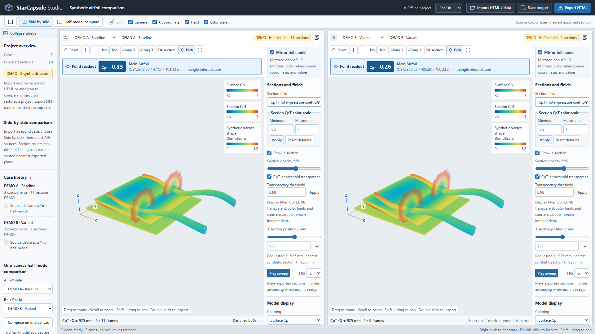

# StarCapsule

**Your STAR-CCM+ results. One portable, interactive, offline HTML.**

[中文说明](README.zh-CN.md) · [Installation](docs/INSTALL.md) · [Review guide](docs/REVIEW.md) · [STAR adapter](docs/STAR_ADAPTER.md) · [Data format](docs/DATA_FORMAT.md) · [Templates](docs/TEMPLATES.md) · [Validation](docs/VALIDATION.md)

StarCapsule Studio turns selected results from saved STAR-CCM+ simulations into a portable 3D workspace. Send a single HTML file: reviewers can rotate the model, sweep real exported sections, inspect source-valued picks, compare cases and record comments without installing STAR, Python or a server.

Keep geometry, scalar fields, source identities and review settings together. Append results to the same workspace, compare A/B views or two half-models under one camera, then export an HTML that reopens with the cases and review state intact. Use it for design reviews, technical presentations and a portable catalog of selected results. Everything needed for viewing travels with the file; no CDN, cloud account or AI service is required.

Large data slots use lossless gzip with bounded Base64 chunks. Exported geometry and numeric precision are retained without automatic mesh reduction or rounding. Startup releases decoded data text and avoids repeated internal validation; same-canvas comparisons reuse unchanged arrays and store derived compositions as small recipes. Actual speed and capacity still depend on geometry density and the reviewing device. See the [validation record](docs/VALIDATION.md) for measured scope.



The public examples are **synthetic demonstrations**, independent of any team vehicle or CFD result.

## Why StarCapsule

- **Deliver an interactive result, not just an image.** Inspect exported geometry, local scalar values and real sections under freely chosen views.
- **Compare within the same workspace.** Collect multiple cases, select A/B sources and link their views; compare compatible half-models on one canvas.
- **Keep the discussion with the evidence.** Save comments and display state, then reopen or pass the review to another person.
- **Make it your team's deliverable.** Embed local logos, colors, fonts and surrounding content through a validated HTML/CSS template.
- **Reduce setup for recipients.** The selected data and viewer travel in one offline HTML. Native extraction runs through your local STAR installation without manually opening its GUI.

The HTML is a selected-result snapshot, not a replacement for the complete `.sim` or a solver. File and memory requirements depend on what you select. See [project positioning](docs/GITHUB_LAUNCH.md).

## Language

English is the default. Select **简体中文** in the desktop or HTML header to switch in place. The desktop remembers its local preference; exported HTML and project JSON save their language with the review. Source object names, field names and user text keep their original spelling. English and Chinese installation, review and template guides are included.

```powershell
python run.py demo --language en --output review-en.html
python run.py build case.json --language zh-CN --output review-zh.html
```

## Select a SIM and export

For Windows x64, use the complete `StarCapsule-Studio-0.3.0-Windows-x64.zip` release package. Extract the entire ZIP, then double-click **Install.cmd** and launch **StarCapsule Studio** from the desktop. **Launch.cmd** also runs the extracted package directly. Python and Tk are included; the native SIM export still requires your compatible, licensed STAR installation.

See the [installation guide](docs/INSTALL.md) for Chinese installer messages and portable use.

On Windows, double-click **Open Studio.cmd** in the source checkout, or run:

```powershell
python run.py gui
```

After installation, use the **StarCapsule Studio** desktop shortcut, the local `Launch.cmd`, or `starcapsule-gui` in the installed Python environment.

1. Choose a solved `.sim` and click **Read simulation** to inventory its saved state. Leave the STAR executable field empty for local discovery, or select it explicitly.
2. Select vehicle walls in **Boundary surfaces**, and/or existing face objects in **Existing postprocessing**. Boundary lists retain other source boundaries too; choose the vehicle walls for body Cp. The latter tab lists mesh-capable derived parts under their source scenes. Choose the existing scalar, display limits and opacity you need.
3. Optionally enable real X sections. Selected wall bounds supply the initial X start/end; manual edits are preserved, and **Use selected bounds** restores the selected bounds. Choose the fluid region and section count or an explicit X list.
4. Choose an HTML destination and click **Export and open HTML**.

The native Tkinter window stays responsive during background work, shows status, supports cancellation of its owned process, and opens the finished report. **Task folder** opens the latest job's exports and logs. The desktop default is two STAR ranks; increase it only with suitable memory and licensing headroom.

**Finite-volume mesh** offers only source representations confirmed by STAR as finite-volume meshes with saved cells, automatically selecting `Volume Mesh` when available. Localized descriptions retain the exact source name; geometric, proxy, empty and unknown representations are hidden. Mesh presence alone is not evidence of convergence. Re-read the SIM after updating from an older inventory. Labels also distinguish coefficient functions, display-only color limits, spatial section counts and the optional X list; entering that list replaces the start/end/count settings.

The desktop Cp selector offers only an available `PressureCoefficient`; the CpT selector offers only an available `TotalPressureCoefficient`. Both include **Do not export**. Other source scalars remain in the existing-layer coloring selector, retaining their own quantity labels and units rather than being mislabeled as coefficients. A layers-only report can leave Cp/CpT empty. Vehicle-wall selections take priority for automatic X bounds: adding a long wake layer does not redefine vehicle length. Missing bounds remain a visible request for a wall selection or manual coordinates.

## Open a demonstration

Open [examples/review-demo.html](examples/review-demo.html) in a desktop browser with WebGL. Viewing an exported report requires neither Python nor STAR. To generate a new synthetic example with Python 3.10+:

```powershell
python run.py demo --output review.html
```

Windows also has `Open Demo.cmd`. Use a new output filename; the CLI's explicit `--force` option replaces an existing HTML/JSON output. The native export dialog preserves existing HTML files and asks for a new name.

## Review tools

| Tool | Behavior |
| --- | --- |
| Geometry inspection | Rotate, pan, zoom, fit, fullscreen; independent component/layer visibility and opacity |
| Real section sweep | Manual X-plane selection, play/pause and automatic back-and-forth spatial sweep |
| Scalar inspection | Cp/CpT switching; independent surface, section and layer color limits; editable CpT transparency threshold; source-valued picking |
| Two-view comparison | Append exported HTML or case JSON, select any A/B cases, and link cameras, physical section position, scalar and color limits independently |
| Same-canvas half-model comparison | Place source A on −Y and B on +Y under one camera, with source-attributed geometry and picks; two-view comparison remains available |
| Existing postprocessing | Display selected source isosurfaces, planes and other supported face meshes, with optional scalar values |
| Editing and comments | Edit report/case names; collapse the sidebar; right-click to record a comment and restore its scientific display state |
| Portable output | Save all loaded cases, selected A/B views, settings and comments in a new standalone HTML; reopen offline and continue choosing cases |

**Add a second result:** click **Import HTML / data**, choose another exported `.html`/`.htm` or a single `case.json`, then use **Compare** and select the desired A/B sources. Repeating import builds a multi-case library; only the selected two are rendered. Importing `project.json` instead restores that entire project, replacing the open project. HTML import reads validated embedded data only: the current editor and template remain in use; imported page scripts, styles and external elements are not executed or copied. See the [review guide](docs/REVIEW.md) for the complete workflow.

Two-view comparison accepts different section counts: X linking selects each source's nearest exported physical plane and exposes its actual position. Same-canvas half-model stitching is stricter. It requires two distinct actual Y=0 half-model sources in consistent coordinates, and its shared section sweep uses only common actually exported X planes and shared fields. Equal section counts alone do not establish matching coordinates. With zero common planes, surfaces/layers remain comparable; one common plane supports a fixed section comparison. A spatial sweep needs at least two common planes.

If a genuine half-model was exported without the half-model flag, its case-library checkbox **I confirm the source is a Y=0 symmetric half-model** records the user's explicit symmetry declaration after a one-sided geometry check. It preserves raw arrays/source identity and does not enable automatic full-car mirroring. The declaration can be undone before use in a composition; once referenced, it stays locked to preserve that composition and its comments. Source-declared half models retain their original declaration. Coefficient references remain attached separately; comparison does not normalize them automatically.

**Hide high-CpT background:** enable **CpT ≥ threshold: transparent**, enter a finite threshold and apply. The default is **0.98**; values at or above the threshold become transparent on CpT sections. Color limits remain independent and do not change which values pass the transparency filter. Cp sections and body Cp use their own controls; raw fields and saved readouts remain unchanged.

The compact desktop layout gives most space to the 3D stage. **Collapse / Expand sidebar** changes only the sidebar width; its preference travels with the project. Scientific settings scroll independently from the canvas.

Portable HTML supports **up to 32 cases in the complete project**, including derived compositions, **500 MiB per original-case or project-manifest slot**, **1 MiB per composition recipe**, and **2 GiB per HTML file**. Large multi-case output uses separate embedded case scripts so saving does not require one aggregate JSON string. These are validation ceilings, not a memory, speed or device-capacity guarantee: geometry density, active layers and the two selected views still determine actual resource use. Project JSON import/save is limited to 500 MiB; use **Export HTML** for a larger combined project. Neither format downsamples the source automatically.

Internal review snapshots copy editable metadata while retaining source numeric arrays. Same-canvas composition reuses unchanged source arrays, allocating reflected geometry where required. Saved HTML retains the originals once and records derived half-stitch cases as bounded recipes instead of storing another full set of their source arrays; reopening reconstructs and validates the display composition. Legacy full-case reports remain readable. This reduces avoidable duplication, while practical capacity still depends on available system memory and browser/GPU resources.

Color limits affect appearance, not stored values. Missing fields stay missing. A geometry-only mesh has no scalar readout. An exported isosurface is genuine source mesh data; this viewer does not calculate an arbitrary new vortex structure from an HTML file.

Geometry-only STL uses exact coordinate indexing, preserving triangle corners and winding while reducing repeated coordinate storage; it does not reconstruct native shared topology. Structure and dense numeric arrays have separate bounded validation budgets in Python and the browser. Oversized selections receive a specific limit message; no automatic downsampling or missing-value filling is applied.

## Editable local templates

The desktop header's **Choose template…** opens a local template folder; **Reset template** returns to the built-in layout. The choice survives SIM changes during the current session. Export an editable starting pack:

```powershell
python run.py templates --output my-templates
python run.py validate-template my-templates/engineering-blue
python run.py demo --template my-templates/engineering-blue --output themed-review.html
```

A pack contains `template.json` with schema `cfd-review-template`, version `1`, a name, and at least one local HTML/CSS file. A full layout preserves the application slot and seven required engine/data hooks; CSS-only packs use the built-in layout. Supported local images/fonts are embedded into the output. External resources and extra JavaScript are outside this template contract. Large reports can contain engine-generated case-data scripts after the project hook; the same seven authored hooks remain unchanged. See [Templates](docs/TEMPLATES.md) for the complete requirements and an AI-editing handoff.

The official software and export workflow display the fixed small creator credit **Designed by Symn**, with no template setting to hide or rename it. This is product attribution rather than tamper-proof DRM or an additional license condition: the source remains editable, and MIT does not require a visible UI watermark. Preserve the applicable copyright/license notices when redistributing code and dependencies.

## Data and command-line workflow

The proprietary SIM is opened by a compatible, licensed local STAR installation. Python prepares an owned Java macro, validates its outputs and builds HTML; the browser never parses SIM files. Existing Scenes are optional for new wall/section exports. Existing layer export uses the selected derived parts and the saved mesh/fields needed to evaluate them.

```powershell
# Source checkout; installed users can replace "python run.py" with "starcapsule".
python run.py doctor
python run.py inspect "YOUR_SOLVED_CASE.sim" --output inventory --compile --run

# Replace the example's exact object/field names and reference metadata first.
python run.py export examples/star-config.example.json --output native-export --compile --run
python run.py build native-export/case.json --output review.html

# Already exported CSV/STL needs no STAR process.
python run.py pack examples/pack-config.example.json --output packed-case.json
python run.py build packed-case.json --output packed-review.html
python run.py build examples/synthetic-a.json examples/synthetic-b.json --output comparison.html
python run.py validate examples/project-synthetic.json

# Refresh an older report with current viewer assets, using a new filename; no STAR run.
python run.py upgrade old-review.html --output updated-review.html
```

`inspect` and `export` prepare files unless `--run` is present. `--compile` checks the macro against local STAR libraries; these commands use a new/empty output directory. Actual runs verify source SHA256, size and modification time. They do not solve, remesh, initialize, clear or save the source SIM. See the [adapter guide](docs/STAR_ADAPTER.md) for existing-layer configuration, licensing and failure receipts.

## Installation and offline operation

Use Python 3.10+ with Tkinter for the desktop interface. Install a supplied wheel without a package index:

```powershell
python -m pip install --no-index starcapsule_studio-0.3.0-py3-none-any.whl
starcapsule-gui
```

Alternatively run the source checkout directly, or install it with `python -m pip install .`. Source builds may download their build backend. Runtime Python dependencies are standard-library modules; exported HTML embeds Three.js, OrbitControls, data and template assets and opens through `file://` without network requests. STAR export still follows your license arrangement; a network license can require a reachable license server.

For compressed HTML, use a desktop browser with WebGL and native `DecompressionStream('gzip')`; this workflow is verified locally with Chromium. The previous `cfd-review` and `cfd-review-gui` command aliases remain available.

The current native API profile is **STAR-CCM+ 19.02.009**. The [validation record](docs/VALIDATION.md) distinguishes actual native exports, synthetic tests, packaging checks and remaining limits. Compilation and a synthetic browser check do not establish that every source isosurface, model size or STAR version exports successfully. New planes and changed isovalues require source data and another export. The sweep is spatial. Unrecorded transient history cannot be reconstructed by exporting a saved state.

## Development

```powershell
python -m pip install -e ".[dev]"
python -m playwright install chromium
python -m unittest discover -s tests -v
python run.py demo --language zh-CN --output demo-check.html
python tools/check_studio.py --html demo-check.html --output checks/browser
python tools/check_language.py --output checks/language
```

Python handles validation, packing, the native desktop workflow and report generation; plain JavaScript/Three.js handles review, and Java macros bridge STAR. See [Contributing](CONTRIBUTING.md). The repository is prepared for GitHub publication; local preparation does not publish it.

## Inspiration

Inspired by the simulation and design-review workflows of **JLU Racing GSmart**.

Designed by **Symn**.

## License

Original code is MIT licensed. Bundled Three.js r146 and matching OrbitControls retain their MIT notices. STAR-CCM+ and its libraries are separately licensed and are not distributed. See [Third-party notices](THIRD_PARTY_NOTICES.md).
